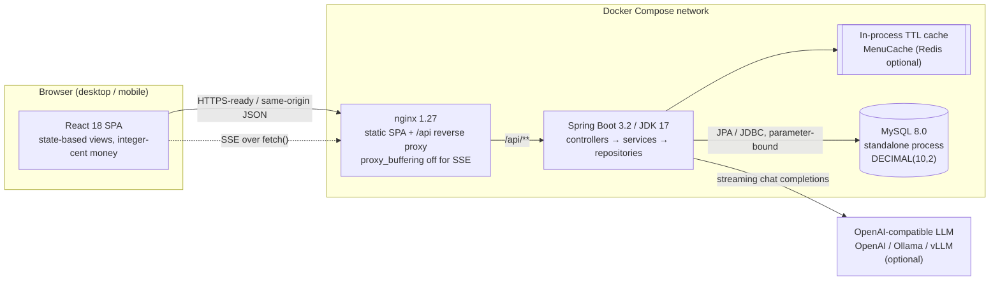

# WeBox — Architecture

## 1. System context



Mandatory infrastructure from PRD §7.1 is honoured exactly:
`frontend SPA → Spring Boot (JDK 17) → independent MySQL process`. Redis is optional and was
deliberately not required; the cache is an explicit, replaceable component.

## 2. Module boundaries

| Module | Responsibility | Key classes |
|--------|----------------|-------------|
| `config` | Env-driven settings with startup validation (fail fast), CORS allowlist, interceptor registration | `AppProperties`, `WebConfig` |
| `common` | Uniform API envelope, typed errors, global handler, request ID + structured JSON logs, money/time/text helpers, business enums | `ApiResponse`, `ApiException`, `GlobalExceptionHandler`, `RequestIdFilter`, `Money`, `AppClock`, `Constants` |
| `security` | PBKDF2 hashes, HS256 access tokens, RBAC annotation + interceptor | `PasswordHasher`, `JwtUtil`, `AuthInterceptor`, `RequireRole` |
| `entity` / `repository` | MySQL mapping, Specifications for safe search, native atomic stock updates, dashboard aggregates | 9 entities, 9 repositories |
| `service` | All business logic; controllers never contain rules | `OrderService`, `OrderRules`, `PricingService`, `MenuService`, `MenuCache`, `ConsoleService`, `DashboardService`, `AiRecommendService`, `SseHub`, `DishAssembler` |
| `controller` | Parse request → call service → format response | `AuthController`, `MenuController`, `OrderController`, `ConsoleController`, `AiController`, `HealthController`, `FileController` |

The layering rule is strict: services never see `HttpServletRequest`/`Response`, controllers never
compute prices or validate ordering rules, and repositories never decide business policy. Pure
rules (`OrderRules`, `PricingService`, `AllergenMatcher`, `Money`) are plain Java and unit-tested
without Spring.

## 3. Core data flow — placing an order

```mermaid
sequenceDiagram
  participant U as Employee SPA
  participant C as OrderController
  participant S as OrderService
  participant DB as MySQL 8
  participant SSE as SseHub

  U->>C: POST /api/orders + Idempotency-Key
  C->>S: place(userId, request, key)
  S->>DB: SELECT order by idempotency_key
  alt key already used
    S-->>U: existing OrderView (no new order)
  else first attempt
    S->>DB: BEGIN; SELECT users FOR UPDATE (same-user serialisation)
    S->>S: resolve cutoff → meal/date; check duplicate active order
    S->>S: validate ≤5 portions, options, recompute prices (integer cents)
    S->>DB: UPDATE daily_menu SET remaining_qty = remaining_qty - qty<br/>WHERE ... AND remaining_qty >= qty
    alt affected rows = 0
      S->>DB: ROLLBACK
      S-->>U: 409 STOCK_INSUFFICIENT with dish names
    else all decrements succeeded
      S->>DB: INSERT orders + order_items; COMMIT
      S->>S: invalidate MenuCache (post-commit)
      S->>SSE: broadcast stock events
      SSE-->>U: stock event → other tabs update without refresh
      S-->>U: OrderView with order no. + delivery info
    end
  end
```

### Concurrency and correctness decisions

| Concern | Decision |
|---------|----------|
| Double submit | Stable `Idempotency-Key` from the checkout page + DB `UNIQUE(idempotency_key)`; a concurrent loser catches `DataIntegrityViolationException` **outside** the transaction and returns the winning order. |
| Same user, two orders for one meal | `SELECT ... FOR UPDATE` on the user row inside the transaction serialises that employee's submissions before the duplicate check. |
| Overselling | One atomic conditional `UPDATE ... WHERE remaining_qty >= :qty` per dish (InnoDB row lock). No read-modify-write in Java. Zero affected rows ⇒ whole transaction rolls back. |
| Order cancellation | `LEAST(total_qty, remaining_qty + qty)` restores stock but never exceeds the declared supply. |
| Real-time stock | `SseEmitter` registry with 20 s heartbeats; post-commit broadcast. Console edits push a `refresh` event. |
| Hot menu reads | `MenuCache` (TTL 30 s, read-through, hit/miss counters). **Write-invalidate** on order, cancel, dish edit, availability toggle, daily-menu edit and preference change. |
| SQL injection | All keyword/category filters use JPA `Specification` parameter binding; LIKE wildcards `%` `_` are escaped with `ESCAPE '\'`; enum values whitelisted; length capped at the boundary. No string concatenation SQL. |
| RBAC | `AuthInterceptor` verifies JWT on every `/api/**` (except an explicit public allowlist) and checks `@RequireRole("ADMIN")` on the whole Console controller → 403 for employees. |
| Price precision | Integer cents in API/JS/services; `DECIMAL(10,2)` only in MySQL. `Math.addExact`/`multiplyExact` guard overflow. |
| Input safety | Bean Validation on DTOs, `TextUtil.clean` length caps and control-character stripping, whitelisted enums, 5 MB upload cap with content-type allowlist and path-traversal check. |

## 4. Authentication flow

1. `POST /auth/login` → access token (JSON body, **memory only**) + refresh token in an
   `HttpOnly; SameSite=Lax; Path=/api/auth` cookie; only its SHA-256 hash is stored in MySQL.
2. On every page load the SPA calls `/auth/refresh`; the server rotates the refresh token
   (old one revoked) and issues a fresh access token → login survives a reload.
3. A 401 triggers one automatic refresh + retry in the API client; 4xx never retries, 5xx retries
   up to 3 times with backoff, network failure shows an offline message.
4. No token is ever stored in `localStorage` or in a URL. SSE uses `fetch()` streaming precisely so
   the token can stay in the `Authorization` header.

## 5. Data model

```
users 1─n refresh_tokens          users 1─1 preferences
users 1─n orders 1─n order_items
dishes 1─n option_groups 1─n option_items
dishes 1─n daily_menu (unique(menu_date, dish_id), remaining_qty, version)
```

Migrations `V1__schema.sql` / `V2__seed.sql` are versioned, idempotent SQL executed at startup by
Spring SQL init. `orders.total_amount`, `dishes.price`, `option_items.extra_price` and
`order_items.unit_price/subtotal` are `DECIMAL(10,2)`. Indexes support the hot paths:
`idx_dish_category`, `uk_menu_date_dish`, `idx_orders_rule`, `idx_orders_date_status`,
`orders.idempotency_key` (unique).

## 6. AI recommendation path

```
SPA (English prompt) → POST /api/ai/recommend (SSE)
  → server-side candidate builder:
      today's menu ∧ active ∧ remaining>0
      − dishes containing flagged allergens
      − dishes ordered in the last 7 days
  → optional LLM stream (OpenAI-compatible /chat/completions, stream=true)
      real token deltas forwarded to the SPA as `delta` events
      [[DISH:id]] markers parsed into dish ids
  → fallback: built-in ranking engine streams word-group reasoning
  → `dish` events (dish cards with personalised English reasons) + `done`
```

Hard constraints are enforced by the server, not the prompt: a hallucinated or unsafe id is dropped
unless it exists in the pre-filtered candidate set. A missing API key or an unreachable model
degrades to the local engine mid-stream, so the feature always runs.

## 7. Operational concerns

- **Configuration**: every setting comes from environment variables via `application.yml`;
  `@Validated` binding fails startup on a missing/short JWT secret.
- **Observability**: one structured JSON line per request (`requestId`, method, path, status,
  duration) plus business events; no passwords, tokens or emails are logged.
- **Health**: `/health` (liveness) and `/ready` (`SELECT 1` through the real pool); MySQL has a
  Compose healthcheck and the backend waits for it.
- **Shutdown**: `server.shutdown=graceful` with a 20 s phase; SSE emitters are closed on completion.
- **Delivery**: multi-stage images (Maven/JDK17 → JRE17; Node20 → nginx), named volumes for MySQL
  data and uploads, explicit CORS origins, security response headers.
